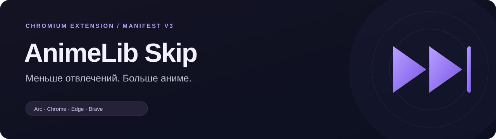

  

  
  
  

  <b><a href="https://github.com/MixNot/animelib-skip/releases/download/v1.1.0/animelib-skip-1.1.0.zip">Скачать v1.1.0</a></b>
  · <a href="#установка">Установка</a>
  · <a href="CHANGELOG.md">Что нового</a>
  · <a href="https://github.com/MixNot/animelib-skip/issues">Сообщить о проблеме</a>

---

# AnimeLib Skip

Расширение Manifest V3 для браузеров на Chromium, которое очищает интерфейс [AnimeLib](https://animelib.org) и отключает отдельные рекламные вставки в плеерах **Animelib** и **Kodik**.

## Что умеет

| Возможность | v1.0.0 | v1.1.0 |
| :--- | :---: | :---: |
| Видеореклама встроенного Animelib | ✓ | ✓ |
| Видеореклама Kodik внутри AnimeLib | — | ✓ |
| Резервные рекламные вставки Kodik | — | ✓ |
| Баннеры и пустые места под ними | — | ✓ |
| Кнопки «Отключить рекламу» и рекламные подписи | — | ✓ |
| Очистка после переходов и переключения серий | ✓ | ✓ |

**Animelib:** войди в профиль сайта и выбери этот плеер. **Kodik:** вход в профиль не нужен.

## Установка

**Сборка не нужна.** Достаточно скачать ZIP, распаковать его и выбрать папку в браузере.

1. Открой [страницу релиза](https://github.com/MixNot/animelib-skip/releases/tag/v1.1.0).
2. В блоке **Assets** скачай **`animelib-skip-1.1.0.zip`**.
3. Найди архив в Finder и **дважды нажми на него**. Появится папка `animelib-skip-1.1.0`. Перемести её в постоянное место, например `Документы/Расширения/`.
4. Открой страницу расширений своего браузера — адреса приведены в таблице ниже.
5. Включи **Developer mode / Режим разработчика** в правом верхнем углу страницы расширений.
6. Нажми **Load unpacked / Загрузить распакованное расширение**.
7. Выбери распакованную папку `animelib-skip-1.1.0`, внутри которой лежит **`manifest.json`**.
8. Полностью перезагрузи открытую вкладку AnimeLib и запусти серию.

> **ZIP не выбирается?** Закрой окно выбора и сначала распакуй архив в Finder. Браузер принимает папку с `manifest.json`.
>
> Это режим разработчика **на странице расширений**. Отдельный режим разработчика вкладки Arc включать не требуется.

### Браузеры

Один и тот же архив предназначен для браузеров на Chromium. Отдельно Chrome, Edge и Brave ещё не тестировались; сквозная проверка воспроизведения в Arc также остаётся открытой.

| Браузер | Страница расширений |
| :--- | :--- |
| Arc | `arc://extensions` |
| Google Chrome | `chrome://extensions` |
| Microsoft Edge | `edge://extensions` |
| Brave | `brave://extensions` |

Шаги одинаковые: режим разработчика → загрузить распакованное расширение → выбрать папку. Требуется Chromium 111 или новее. Safari и Firefox эту сборку не поддерживают.

Если скачиваешь репозиторий через **Code → Download ZIP**, после распаковки выбирай вложенную папку **`extension`**.

## Если что-то не работает

<b>Нет кнопки Animelib в списке плееров</b>

Войди в свой профиль AnimeLib, открой серию и выбери **Animelib** в списке плееров. У гостей сайта обычно доступен Kodik.

<b>Расширение включено, но реклама осталась</b>

Полностью перезагрузи вкладку после установки или обновления расширения. Проверь выбранный плеер и номер версии на карточке расширения. В версии 1.0.0 поддерживается только Animelib; Kodik добавлен в 1.1.0.

Если проблема повторяется, [создай issue](https://github.com/MixNot/animelib-skip/issues/new): укажи версию Arc, версию расширения, выбранный плеер и ссылку на серию. Пароли, cookies и токены присылать не нужно.

<b>Как временно отключить расширение</b>

Открой `arc://extensions`, выключи переключатель на карточке **«AnimeLib — пропуск видеорекламы»** и перезагрузи вкладку сайта.

## Обновление с v1.0.0

1. Скачай и распакуй ZIP нового релиза.
2. Скопируй его файлы в **ту же папку**, из которой установлено расширение, с заменой старых файлов.
3. Открой `arc://extensions` и нажми значок **↻** на карточке расширения.
4. Убедись, что версия стала **1.1.0**, затем перезагрузи вкладку AnimeLib.

Если не помнишь установленную папку, удали старую версию на странице расширений и установи новую по инструкции выше. Одновременно держать две версии не нужно.

> Установленное вручную расширение обновляется вручную. Новый релиз на GitHub сам по себе не обновляет файлы в Arc.

## Приватность и доступ

| Доступ | Зачем нужен |
| :--- | :--- |
| `https://animelib.org/*` | Очистка интерфейса и поддержка переходов к просмотру внутри сайта |
| `https://kodikplayer.com/*` и его поддомены | Обработка Kodik, встроенного в AnimeLib |

Скрипт Kodik проверяет родительскую страницу и включается только внутри AnimeLib. Открытый отдельно Kodik и его встраивания на других сайтах не меняются.

Расширение не читает пароли и cookies, не отправляет данные на собственные серверы, не меняет аккаунт, подписку или прогресс просмотра. Дополнительные API-разрешения не запрашиваются.

## Как работает

- **Animelib:** отклоняет загрузку рекламного AdLoader; плеер продолжает серию через собственный обработчик.
- **Kodik:** перед созданием плеера и при обновлении серии очищает основной и резервный списки VAST, отключает мини-баннер и отдельный рекламный скрипт. Ссылки на серию, качество и субтитры сохраняются.
- **Интерфейс:** скрывает рекламные контейнеры целиком, включая отступы, и отдельные рекламные подписи. Комментарии и редактор сообщений исключены из очистки.

## Проверка и ограничения

**11 автоматических проверок пройдены**, включая проверку на текущем коде ядра Kodik и обработчике продолжения AnimeLib. Сквозное воспроизведение с установленной v1.1.0 в Arc ещё требует подтверждения.

Изменения кода сайта или домена плеера могут потребовать обновления. Вшитые в само видео вставки не удаляются. Баннеры скрываются визуально; их фоновые сетевые запросы отдельно не блокируются.

Неофициальный проект, не связанный с администрацией AnimeLib или Kodik. Совместимость с Chrome, Edge и Brave ожидается по Manifest V3; отдельно эти браузеры не проверялись.
